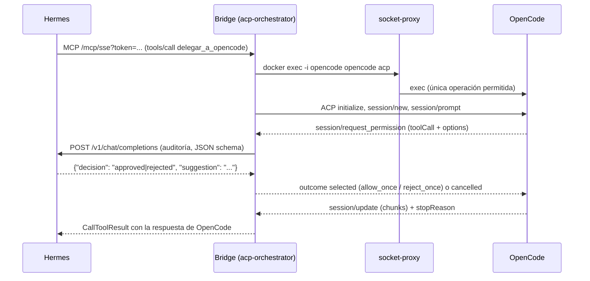

# Hermes-OpenCode Bridge 🌉🤖

[](https://github.com/tecno-consultores/hermes-opencode-bridge/actions/workflows/ci.yml) [](https://deepwiki.com/tecno-consultores/hermes-opencode-bridge)  [](https://hub.docker.com/r/sinfallas/hermes-opencode-bridge)

Esta imagen fue diseñada para trabajar dentro del proyecto: https://github.com/tecno-consultores/llm-lab

Microservicio FastAPI que funciona como servidor **Model Context Protocol (MCP)** y puente hacia
**OpenCode (agente worker)** mediante **Agent Client Protocol (ACP)**, para que **Hermes (agente manager)**
le delegue tareas de programación y ejecución en terminal dentro de un entorno Dockerizado (`/workspace`),
con una **capa de auditoría de seguridad** en la que Hermes aprueba o rechaza cada acción sensible.

> [!WARNING]
> Este servicio permite **ejecutar código** a través de un agente LLM. Lea [SECURITY.md](SECURITY.md)
> antes de desplegarlo y nunca lo exponga a Internet.

## ✨ Características principales

* **MCP con dos transportes:** SSE en `/mcp/sse` (el que usa `hermes mcp add`) y Streamable HTTP en
  `/mcp`. Ambos exigen el token `ACP_API_KEY`.
* **Herramienta `delegar_a_opencode`:** la llamada **espera** a que OpenCode termine (o a que expire
  `OPENCODE_TASK_TIMEOUT`) y devuelve la respuesta del agente. Las tareas se ejecutan de una en una por
  defecto (`MAX_CONCURRENT_TASKS`).
* **ACP nativo:** habla JSON-RPC por `stdio` con `opencode acp` mediante `docker exec`, a través de un
  proxy del socket Docker que solo permite `exec` en el contenedor `opencode`.
* **Auditoría de seguridad fail-closed:** cada `session/request_permission` de OpenCode se envía a Hermes,
  que responde con un JSON estricto (`decision` + `suggestion`). Si Hermes falla o responde algo inválido,
  la acción se **rechaza**. Nunca se concede "permitir siempre".
* **Retroalimentación:** si Hermes rechaza una acción con una sugerencia, al terminar el turno se envía un
  nuevo prompt a OpenCode con esa sugerencia (máximo `MAX_FEEDBACK_ROUNDS` rondas).
* **Auto-registro "Zero-Touch":** Hermes puede registrar el servidor MCP por sí mismo (ver más abajo).

## 🏗️ Flujo



1. **Auto-registro:** Hermes detecta que no tiene la herramienta y ejecuta `hermes mcp add` con la URL del puente.
2. **Handshake MCP:** Hermes se conecta a `/mcp/sse` con su token y recibe la herramienta `delegar_a_opencode`.
3. **Delegación:** Hermes invoca la herramienta; el puente abre una sesión ACP con OpenCode y espera el resultado.
4. **Auditoría y retroalimentación:** cada permiso que solicita OpenCode se audita con Hermes. Los rechazos
   con sugerencia se reinyectan como un nuevo prompt cuando termina el turno.

## 🚀 Instalación y despliegue

```bash
cp env.example .env && chmod 600 .env
# Edite .env: reemplace TODOS los CHANGE_ME (openssl rand -hex 32) y ajuste DOCKER_GID:
stat -c %g /var/run/docker.sock
docker compose --env-file .env --profile acp-orchestrator up -d
```

El perfil `acp-orchestrator` levanta `opencode`, `hermes`, `socket-proxy` y `acp-orchestrator`.
Por defecto el puente (`8000`) y la web de OpenCode (`OCPORT`) solo se publican en `127.0.0.1`.

### Variables de entorno del puente

| Variable | Por defecto | Descripción |
|---|---|---|
| `ACP_API_KEY` | — (obligatoria) | Token que deben presentar los clientes MCP (`Authorization: Bearer` o `?token=`). Sin ella se rechazan todas las conexiones. |
| `HERMES_API_URL` | `http://hermes:8642/v1/chat/completions` | Endpoint OpenAI-compatible del auditor. |
| `HERMES_API_KEY` | vacío | Token Bearer para la API de Hermes. |
| `HERMES_MODEL` | `hermes` | Modelo enviado al auditor. |
| `HERMES_TIMEOUT` | `15` | Segundos máximos por auditoría (si expira, se rechaza). |
| `HERMES_SECURITY_PROMPT` | prompt interno | Prompt del auditor. Use `{accion}` donde insertar la acción; si falta, se anexa al final. Vacío = prompt interno. |
| `DOCKER_HOST` | — | En compose: `tcp://socket-proxy:2375`. |
| `OPENCODE_CONTAINER` | `opencode` | Contenedor donde se ejecuta `opencode acp`. |
| `OPENCODE_WORKSPACE` | `/workspace` | Directorio de trabajo de la sesión ACP. |
| `OPENCODE_TASK_TIMEOUT` | `900` | Límite en segundos por tarea delegada. |
| `MAX_CONCURRENT_TASKS` | `1` | Tareas de OpenCode simultáneas. |
| `MAX_FEEDBACK_ROUNDS` | `3` | Re-prompts máximos tras rechazos del auditor. |
| `MCP_ALLOWED_HOSTS` | `acp-orchestrator:*,localhost:*,127.0.0.1:*` | Protección DNS-rebinding (lista de `Host` válidos; vacío = desactivada). |
| `ACP_ENABLE_DOCS` | `false` | Expone `/docs` y `/openapi.json` (solo QA/desarrollo). |
| `LOG_LEVEL` | `INFO` | `DEBUG` muestra instrucciones, sugerencias y stderr de OpenCode. |

### Uso fuera del compose incluido

Si integra la imagen en otro stack, conserve el proxy del socket (ver el servicio `socket-proxy` en
[docker-compose.yml](docker-compose.yml)) en lugar de montar `/var/run/docker.sock` en el puente:

```yaml
services:
  acp-orchestrator:
    image: sinfallas/hermes-opencode-bridge:1.6.0
    container_name: acp-orchestrator
    networks: [acp-net, acp-docker-net]
    environment:
      - ACP_API_KEY=${acpapikey}
      - HERMES_API_URL=http://hermes:8642/v1/chat/completions
      - HERMES_API_KEY=${hapikey}
      - DOCKER_HOST=tcp://socket-proxy:2375
    read_only: true
    tmpfs: ["/tmp:size=32M,noexec,nosuid,nodev"]
    cap_drop: [ALL]
    security_opt: ["no-new-privileges:true"]
    depends_on:
      socket-proxy: {condition: service_healthy}
      opencode: {condition: service_healthy}
      hermes: {condition: service_healthy}
```

## 🔌 Integración automática (System Prompt)

Para un despliegue "Zero-Touch", la variable `learning_acp_orchestrator` del contenedor de Hermes contiene el
protocolo de auto-ensamblaje. En `env.example` el token se interpola automáticamente desde `acpapikey`:

```text
Role: Lead DevOps Manager. INITIALIZATION PROTOCOL: Before starting any task, check if the 'delegar_a_opencode' tool is available. If NOT, use your local terminal to execute exactly: '/opt/hermes/.venv/bin/hermes mcp add acp-orchestrator --url http://acp-orchestrator:8000/mcp/sse?token=<ACP_API_KEY>'. OPERATING RULES: You are the orchestrator. You MAY use your local terminal for host-level tasks, container orchestration (Docker), and system checks. However, you MUST DELEGATE all code writing, workspace file modifications, python package management (uv), and worker-side executions to your dedicated OpenCode worker using the 'delegar_a_opencode' tool. Provide the worker with highly detailed, step-by-step instructions. The tool call blocks until OpenCode finishes. IMPORTANT SECURITY AUDIT: You monitor the worker. If prompted to evaluate a potentially dangerous action from OpenCode, switch to auditor mode. You MUST reply strictly conforming to the requested JSON schema, providing a 'decision' (strictly 'approved' or 'rejected') and a 'suggestion' (a brief explanation or alternative if rejected, otherwise empty).
```

> [!TIP]
> Si prefiere no poner el token en la URL, registre el servidor en `~/.hermes/config.yaml` con una cabecera
> `Authorization: Bearer ...` (bloque `mcp_servers.<nombre>.headers`).

## 🧪 Verificación de conexión

```bash
# Salud (sin autenticación)
curl -s http://127.0.0.1:8000/health
# Sin token => 401
curl -s -o /dev/null -w "%{http_code}\n" http://127.0.0.1:8000/mcp/sse
# Handshake MCP (Streamable HTTP) con token => 200 y serverInfo "acp-orchestrator"
curl -s -X POST http://127.0.0.1:8000/mcp \
  -H "Authorization: Bearer $ACP_API_KEY" \
  -H "Accept: application/json, text/event-stream" -H "Content-Type: application/json" \
  -d '{"jsonrpc":"2.0","id":1,"method":"initialize","params":{"protocolVersion":"2025-06-18","capabilities":{},"clientInfo":{"name":"curl","version":"1"}}}'
```

## 🛠️ Pruebas y aseguramiento de calidad (QA)

Todo se ejecuta en contenedores efímeros sin root definidos en `docker-compose.qa.yml`, con el script
[scripts/qa.sh](scripts/qa.sh). Si su usuario no es `1000:1000`, exporte antes
`export HOST_UID=$(id -u) HOST_GID=$(id -g)`.

**Fase 1: Lint, tipos y pruebas unitarias.** `ruff`, `mypy --strict` y `pytest` (con un agente ACP simulado
y un cliente MCP real en proceso). Exige una cobertura de líneas y ramas ≥ 95 %, en Python 3.10 a 3.14 vía `tox`:
```bash
docker compose -f docker-compose.qa.yml run --rm test
```

**Fase 2: Seguridad y análisis estático (SAST).** `bandit` y `pip-audit`:
```bash
docker compose -f docker-compose.qa.yml run --rm test ./scripts/qa.sh sast
```

**Fase 3: Pruebas de mutación** (`mutmut` en paralelo, exige MSI ≥ 80 %). Ajustable con `MUTATION_CHILDREN`,
`MUTATION_SHARDS` (procesos mutmut independientes) y `MUTATION_MIN_MSI`:
```bash
docker compose -f docker-compose.qa.yml run --rm test ./scripts/qa.sh mutation
```

**Fase 4: Estrés y carga.** `locust` mide `/health`, el handshake MCP autenticado y el rechazo 401 con 100
usuarios concurrentes. Requiere la API levantada:
```bash
docker compose -f docker-compose.qa.yml up -d --wait api
docker compose -f docker-compose.qa.yml run --rm test ./scripts/qa.sh load
```

**Fase 5: Contratos y fuzzing (Schemathesis)** sobre el esquema OpenAPI (requiere la API levantada):
```bash
docker compose -f docker-compose.qa.yml run --rm test ./scripts/qa.sh fuzz
```

**Fase 6: Integración end-to-end (modo desarrollo).** Construye la imagen local y monta `acp_api.py` con
recarga automática sobre el stack real:
```bash
docker compose --env-file .env -f docker-compose.yml -f docker-compose.dev.yml --profile acp-orchestrator up -d --build
docker compose --env-file .env -f docker-compose.yml -f docker-compose.dev.yml logs -f acp-orchestrator
```
Las pruebas marcadas como `integration` (Hermes y OpenCode reales) se ejecutan con `pytest -m integration`
desde un contenedor conectado a la red `acp-net`.

Para limpiar los artefactos locales de QA: `./limpieza.sh`.

## 📚 Documentación del proyecto

- [CHANGELOG.md](CHANGELOG.md): historial de cambios.
- [SECURITY.md](SECURITY.md): modelo de amenazas y reporte de vulnerabilidades.
- [CONTRIBUTING.md](CONTRIBUTING.md): flujo de trabajo, versionado y requisitos de QA.
- [TESTING.md](TESTING.md): estrategia y pirámide de pruebas.

Obtener la imagen en Docker Hub: https://hub.docker.com/r/sinfallas/hermes-opencode-bridge

Copyright (C) 2026 Jesus Palencia <sinfallas@gmail.com> (Creado en Tecno Consultores). Licencia [GPL-2.0-only](LICENSE).
